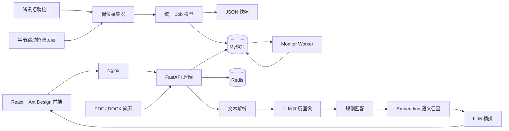
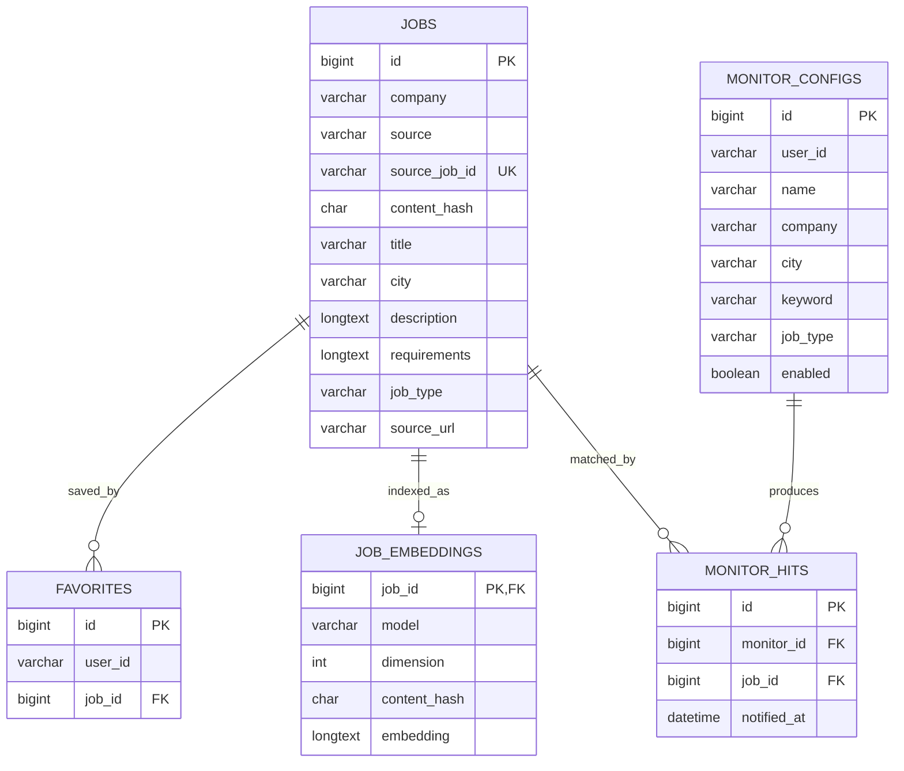

# AI 实习信息平台

一个面向实习岗位的采集、检索和智能匹配平台。项目会把腾讯、字节跳动等招聘网站的岗位统一采集到 MySQL，再通过 FastAPI 提供查询接口，并使用 React 前端展示。

> 项目定位：一个可本地运行的全栈招聘信息聚合与 AI 岗位推荐示例。

## 产品预览

平台前端包含四个主要区域：

- **岗位大厅**：按公司、城市、岗位类型和关键词检索岗位。
- **AI 智能推荐**：上传 PDF/DOCX 简历，获得岗位匹配结果。
- **我的收藏**：保存感兴趣的岗位，快速回看详情。
- **岗位监控**：配置筛选条件，检查新增或更新的匹配岗位。

## 系统架构



### 请求链路

1. 前端通过 Nginx 将 `/api` 请求转发到 FastAPI。
2. FastAPI 从 MySQL 查询岗位、收藏和监控数据，并使用 Redis 缓存筛选项和匹配结果。
3. 岗位采集器从招聘网站获取数据，统一转换为 `Job`，保存 JSON 后增量同步到 MySQL。
4. 简历匹配先提取文本，再生成结构化简历画像，随后执行规则匹配、可选语义召回和 LLM 精排。
5. 独立的 Monitor Worker 定期检查岗位的新增和更新时间，写入监控命中记录。

## 功能

- 采集腾讯实习岗位：分页调用招聘接口，并补充岗位详情。
- 采集字节跳动实习岗位：通过 Playwright 打开官方页面并捕获真实搜索接口。
- 岗位数据统一建模、内容哈希、去重和增量同步到 MySQL。
- 按公司、城市、岗位类型和关键词搜索，支持排序、分页和岗位详情。
- 浏览器本地用户标识下的岗位收藏。
- 创建岗位监控，手动或由后台 Worker 检查新增、更新岗位。
- 上传 PDF/DOCX 简历，提取简历画像并进行规则匹配、Embedding 召回和 LLM 精排。
- Redis 缓存岗位筛选项和简历匹配结果，并对简历匹配接口进行限流。

## AI 推荐流程

```text
简历文件
  ↓
PDF/DOCX 文本提取
  ↓
LLM 生成 ResumeProfile
  ├─ 教育背景
  ├─ 技能
  ├─ 项目经历
  ├─ 实习/工作经历
  └─ 目标岗位方向
  ↓
规则粗筛 ─────────────┐
                       ├─ 候选岗位合并 → LLM 精排 → Top 10 推荐
Embedding 语义召回 ───┘
```

规则匹配会综合技能、岗位方向、项目/经历相关性和学历/经验门槛。Embedding 索引可按需构建；如果外部 Embedding 或 LLM 服务不可用，系统会尽可能回退到规则匹配。

## 数据模型



## 技术栈

- 后端：Python、FastAPI、PyMySQL、Playwright
- AI：OpenAI 兼容的 LLM/Embedding 接口
- 数据库：MySQL 8
- 缓存：Redis 7
- 前端：React、Vite、Ant Design
- 部署：Docker Compose、Nginx

## 目录结构

```text
src/
  api/           FastAPI 路由
  ai/            简历解析、岗位匹配、Embedding 和 LLM
  collectors/    腾讯、字节跳动岗位采集器
  db/            MySQL 表结构、查询、收藏和监控
  monitor/       岗位监控 Worker
  models.py      统一岗位数据模型
frontend/
  src/           React 页面、组件和 API 客户端
  public/        favicon 和静态资源
data/
  *_jobs.json    示例岗位数据
docker/
  mysql/         MySQL 初始化脚本
Dockerfile        后端镜像
frontend/Dockerfile 前端镜像
docker-compose.yml
                 MySQL、Redis、后端、Worker、前端编排
```

## 配置

复制环境变量模板并填写配置：

```bash
cp .env.example .env
```

Windows PowerShell：

```powershell
Copy-Item .env.example .env
```

至少需要设置：

```dotenv
MYSQL_ROOT_PASSWORD=请替换为强密码
LLM_BASE_URL=https://你的模型服务地址/compatible-mode/v1
LLM_API_KEY=你的模型服务密钥
LLM_MODEL=你的聊天模型名称
```

Embedding 默认使用 `text-embedding-v4` 和 1024 维，可通过 `EMBEDDING_MODEL`、`EMBEDDING_DIMENSION` 修改。`MONITOR_INTERVAL_SECONDS` 控制监控 Worker 的轮询间隔，最小为 30 秒。

不要把 `.env`、真实 API Key、个人简历或其他隐私文件提交到 GitHub。仓库只应提交 `.env.example`。

## Docker 启动

安装 Docker Desktop 后，在项目根目录执行：

```bash
docker compose up -d --build
```

访问：

- 前端：http://localhost:3000
- 后端接口文档：http://localhost:8000/docs
- 健康检查：http://localhost:8000/health

停止服务：

```bash
docker compose down
```

如需连同 MySQL 和 Redis 数据卷一起删除：

```bash
docker compose down -v
```

首次使用 AI 推荐时，在前端点击“更新 Embedding 索引”。没有配置 LLM/Embedding 服务时，岗位搜索、收藏和监控仍可使用，但简历匹配不可用或会回退到规则匹配。

## 本地开发

后端依赖：

```bash
pip install -r requirements.txt
```

Playwright 浏览器：

```bash
playwright install chromium
```

启动后端：

```bash
uvicorn src.api.main:app --reload --host 127.0.0.1 --port 8000
```

启动前端：

```bash
cd frontend
npm install
npm run dev
```

本地开发时，Vite 会把 `/api` 请求代理到 `http://127.0.0.1:8000`。

## 岗位采集和同步

默认采集入口为 `src/main.py`，其中可配置公司、关键词、页数和字节跳动的无头浏览器模式：

```bash
python -m src.main
```

采集结果会写入 `data/tencent_jobs.json` 和 `data/bytedance_jobs.json`，随后同步到 MySQL。也可以单独运行采集器或使用 `src.db.sync` 同步已有 JSON。

## API 概览

| 路径 | 作用 |
| --- | --- |
| `GET /health` | 检查后端和数据库状态 |
| `GET /jobs` | 岗位筛选、排序和分页 |
| `GET /jobs/{job_id}` | 岗位详情 |
| `GET /companies` | 公司选项 |
| `GET /cities` | 城市选项 |
| `GET /job-types` | 岗位类型选项 |
| `GET/POST/DELETE /favorites` | 收藏管理 |
| `GET/POST/PATCH/DELETE /monitors` | 监控配置管理 |
| `POST /monitors/{id}/run` | 手动运行监控 |
| `GET /monitors/{id}/hits` | 查看监控命中 |
| `POST /resume/match` | 上传简历并返回岗位推荐 |
| `GET /ai/embeddings/status` | 查看 Embedding 索引状态 |
| `POST /ai/embeddings/index` | 构建岗位 Embedding 索引 |

### 查询示例

```bash
curl "http://localhost:8000/jobs?company=腾讯&city=深圳&keyword=Python&page=1&page_size=20"
```

### 简历匹配示例

```bash
curl -X POST "http://localhost:8000/resume/match" \
  -F "file=@./resume.pdf"
```


